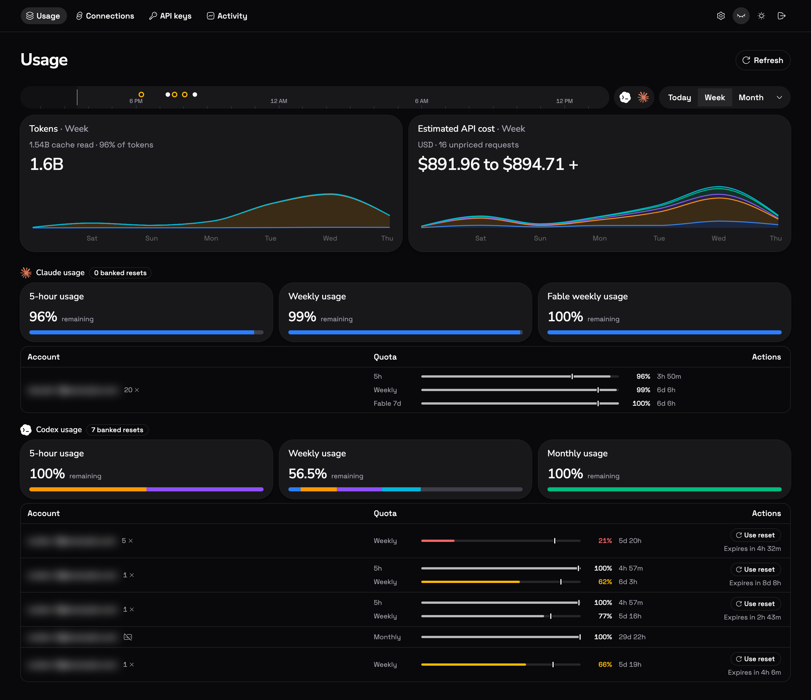
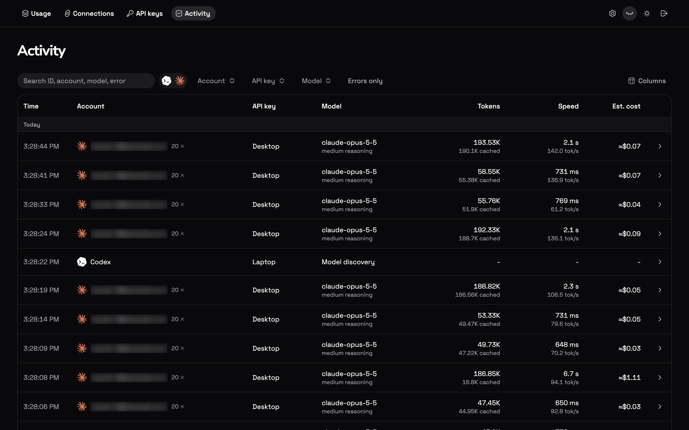
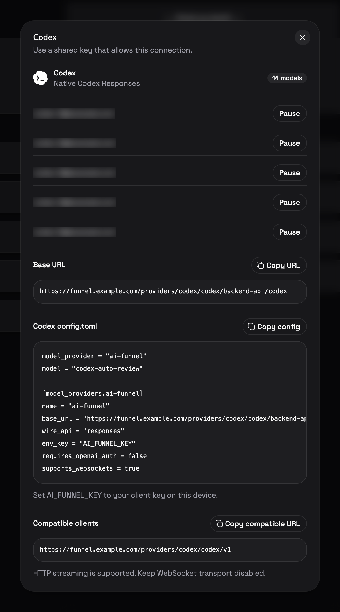
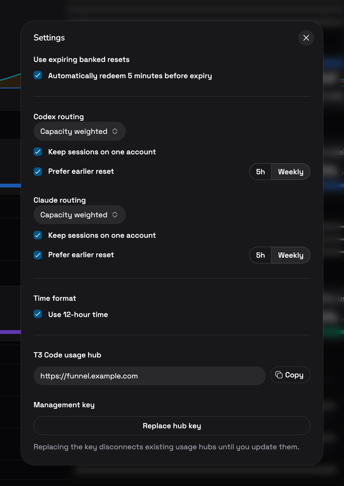

# ai-funnel

A self-hosted proxy that pools your Codex and Claude subscription accounts behind your own API keys. It routes Codex and Claude Code requests across your accounts, tracks quota windows, and logs usage per key.

It runs as one Go service. The backend embeds [CLIProxyAPI v8.0.47](https://github.com/router-for-me/CLIProxyAPI/tree/v8.0.47) for provider login, token refresh and request handling, and serves a React dashboard from the same port. Accounts sign in directly here, so there is no separate CLIProxyAPI or codex-lb deployment to run.



## Features

- **Codex and Claude accounts.** Sign in with OAuth, paste an auth or setup token, or import `~/.codex/auth.json` or Claude Code's `.credentials.json`. Other CLIProxyAPI providers are listed as unsupported.
- **Quota tracking.** Each account shows its 5-hour, weekly and model-specific windows with reset times, refreshed every two minutes. Banked Codex and Claude resets can be redeemed manually or automatically before they expire.
- **Eight routing strategies** per provider, with sticky sessions and a preference for accounts whose window resets soonest. The default is capacity weighted. See [routing](docs/routing.md).
- **Scoped API keys.** Limit a key to providers, accounts and models, set a daily request cap or expiry, and edit any of it later without changing the key value. Codex keys can be restricted to subscription allowance only. Archived keys keep their history and can be restored.
- **Usage and cost.** Token graphs and estimated API-equivalent cost from public OpenAI and Claude price tables, per day, per provider and per key.
- **Activity log.** Searchable request history with account, key, model, transport, latency, time to first token, output speed, tokens and cost. Prompts and responses are not stored.
- **Native transports.** Codex Responses over HTTP, SSE and WebSockets, Claude Messages over HTTP and SSE, with gzip and zstd compression.
- **Encrypted state.** Credentials, keys and settings live in one AES-256-GCM encrypted file.

## Quick start

### Docker

```sh
git clone https://github.com/kopenkinda/ai-funnel.git
cd ai-funnel
docker compose up --build -d
docker compose exec ai-funnel cat /app/data/admin-token
```

The compose file publishes the dashboard on `http://127.0.0.1:4310` only and keeps state in the `funnel-data` volume. The last command prints the dashboard key generated on first start. Set `PUBLIC_URL` in the environment when you serve it from a real hostname.

### From source

You need Go 1.27.3+, Node 24+ and pnpm 10. Node is only a build tool; production runs `bin/ai-funnel` with the built `dist` folder.

```sh
pnpm install --frozen-lockfile
cp .env.example .env
pnpm build
pnpm start
```

In another terminal, read the generated dashboard key:

```sh
cat data/embedded/admin-token
```

| Variable            | Default         | Purpose                                                            |
| ------------------- | --------------- | ------------------------------------------------------------------ |
| `HOST`              | `127.0.0.1`     | Listen address.                                                    |
| `PORT`              | `4310`          | Listen port.                                                       |
| `DATA_DIR`          | `data/embedded` | Encrypted state, master key and dashboard key.                     |
| `PUBLIC_URL`        | unset           | Canonical HTTPS origin, used for setup snippets and origin checks. |
| `DASHBOARD_ORIGINS` | unset           | Extra comma-separated origins allowed to use the dashboard.        |
| `ADMIN_TOKEN`       | unset           | Fixed dashboard key. Without it, one is generated in `DATA_DIR`.   |

The service reads `.env` on startup and logs where the dashboard key is stored, never the key itself. Only one process can use a data directory at a time.

### First login and accounts

1. Open the dashboard and enter the dashboard key.
2. Go to **Connections** and choose **Add account** on the Codex or Claude card.
3. Pick an account source: **OAuth** opens the provider sign-in, **Auth token** takes a pasted token, **JSON file** imports a credential file. If OAuth ends on an unreachable localhost page, paste that full callback URL into the dialog.
4. Go to **API keys**, choose **Add key**, select the providers it may use, and copy the key. Key values are shown once.

Repeat step 2 for every account you want in the pool. Imports apply immediately without a restart. [Accounts and keys](docs/accounts-and-keys.md) covers each source and every key option.

## Connect a client

**URL & setup** on each connection shows the exact base URL and a ready-to-copy snippet for your host. Keep the client key in an environment variable on each device:

```sh
export AI_FUNNEL_KEY='sk-af-...'
```

### Codex

Add to `~/.codex/config.toml`:

```toml
model_provider = "ai-funnel"
model = "<model id from the dashboard>"

[model_providers.ai-funnel]
name = "ai-funnel"
base_url = "https://funnel.example.com/providers/codex/codex/backend-api/codex"
wire_api = "responses"
env_key = "AI_FUNNEL_KEY"
requires_openai_auth = false
supports_websockets = true
```

OpenAI-compatible clients can use `https://funnel.example.com/providers/codex/codex/v1` over HTTP with WebSockets disabled.

### Claude Code

```sh
export ANTHROPIC_BASE_URL='https://funnel.example.com/providers/claude/claude'
export ANTHROPIC_AUTH_TOKEN="$AI_FUNNEL_KEY"
claude
```

Both `Authorization: Bearer` and `x-api-key` headers are accepted. Endpoints, transports and policy checks are listed in [client API](docs/client-api.md).

## Screenshots

<table>
  <tr>
    <td width="50%"><a href="docs/screenshots/api-keys.png"></a></td>
    <td width="50%"><a href="docs/screenshots/activity.png"></a></td>
  </tr>
  <tr>
    <td><a href="docs/screenshots/codex-setup.png"></a></td>
    <td><a href="docs/screenshots/settings-routing.png"></a></td>
  </tr>
</table>

Screenshots use anonymized data. Account emails are blurred by the dashboard's default privacy mode.

## Documentation

- [Accounts and keys](docs/accounts-and-keys.md): account sources, quotas, banked resets, key scopes, subscription-only access, archive, T3 Code usage hub.
- [Routing](docs/routing.md): the eight strategies, plan capacity, quota windows and sticky sessions.
- [Usage and activity](docs/usage-and-activity.md): graphs, cost estimates, pricing sources and retention.
- [Client API](docs/client-api.md): base URLs, transports, compression and request policy.
- [Deployment](docs/deployment.md): storage, backups, Coolify, Tailscale Serve and public HTTPS.
- [Verification](docs/verification.md): what has been tested, including live client runs.

## Development

```sh
pnpm dev          # builds the UI, runs the Go backend against DATA_DIR
pnpm lint
pnpm format:check
pnpm test         # Go tests and Oxlint rule tests
pnpm exec playwright install chromium
pnpm test:ui      # browser tests against an isolated backend
```

`pnpm dev` uses the same `DATA_DIR` as `pnpm start`, so point it at a scratch directory if your normal one holds real accounts. After frontend edits, run `pnpm build:ui` and reload. Restart after Go changes. `pnpm format` runs Prettier and gofmt, and `pnpm lint:fix` applies safe Oxlint fixes. A local Oxlint rule rejects literal em dashes in JS, TS and TSX.

Backend tests run the embedded SDK with controlled executors and isolated state. They do not sign in to real providers.

The UI uses shadcn preset `b13HF9dX9O`. Provider logo sources and licenses are in [public/providers/SOURCES.md](public/providers/SOURCES.md). CLIProxyAPI's license is in [LICENSES/CLIProxyAPI.txt](LICENSES/CLIProxyAPI.txt).
