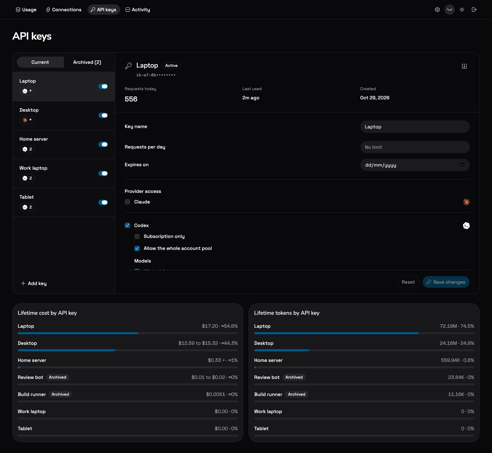

# Accounts and keys

## Adding accounts

Open **Connections**, choose **Add account** on the Codex or Claude card, then pick an account source:

- **OAuth** opens the provider's sign-in. If it ends at an unreachable localhost page, paste that complete callback URL into the dashboard.
- **Auth token** accepts an OAuth access token or a Claude setup token. Codex normally reads the account ID from the token, and you can enter it when needed. A token without refresh credentials works until it expires, then needs replacing.
- **JSON file** imports Codex's `~/.codex/auth.json`, a flat CLIProxyAPI credential file, or Claude Code's `.credentials.json`. Refresh tokens and expiry are kept. Subscription credentials work; API-key-only Codex files are rejected.

Imports go straight into the encrypted store and are usable without a restart. Re-importing a known account keeps its ID, key assignments and pause state. The app never modifies your source file or saves a plaintext copy. Token validity is checked by provider requests, not by parsing the file.

Gemini, Vertex AI, Grok and the other CLIProxyAPI providers appear under **Unsupported** and cannot be connected.

## Quotas

**URL & setup** on a connection lists its accounts, lets you pause or resume each one, and shows the base URL and client configuration. **Refresh** reads quotas from each provider, and background reads run every two minutes. Quotas the provider does not report stay unknown. A failed read keeps the previous value with its timestamp. The dashboard reloads cached metadata every 30 seconds.

Account rows show plan multipliers and any status other than healthy.

## Banked resets

**Use reset** redeems the displayed banked credit, with its expiry shown underneath. It works for Codex and Claude and is independent of automatic redemption.

**Settings → Use expiring banked resets** redeems Codex and Claude credits during their final five minutes. It is off by default and the setting is stored on the server. While the service runs, the scheduler checks every 15 seconds, refreshes credit status before redeeming, and retries temporary failures or `nothing_to_reset` every 30 seconds until expiry.

Claude grants must be usable, and grants without an expiry are shown but never redeemed automatically. Codex uses T3 Code's deterministic request ID. Claude stores one request ID per redemption, reuses it for unconfirmed requests after restarts, and waits for the remaining count to drop before using another reset from the same grant. A successful redemption clears the account's local cooldown. The banked-reset badge shows counts and expiry details.

## API keys

**API keys → Add key** creates a shared key (`sk-af-...`) or registers an existing device key value. Select its providers, accounts and models. Nothing is inherited from another service. Key values are shown once and stored as SHA-256 hashes.

Selecting a key opens its editor. You can change the name, providers, accounts, models, daily request cap and expiry. The key value and usage history stay the same, and changes apply to the next request or WebSocket turn.

Model access uses the same provider catalog as native model discovery. **All models** allows every model, including future ones. Turn it off to pick models from the searchable list.

Daily caps count every authenticated provider request, including model discovery and failed attempts, and reset at midnight UTC.

### Subscription only

**Codex → Subscription only** uses an account only while its live subscription windows have allowance left, including accounts that also have purchased credits. Funnel checks before each execution, retry and WebSocket turn, skips exhausted or unverifiable accounts, and returns 429 when none qualify.

This is a subscription cutoff, not a spending cap. Requests already in flight and delayed provider usage reporting can still spend some purchased credits near the limit.

### Archive

**Archive** revokes a key's access and keeps its settings and lifetime usage. Archived keys are listed under **Archived** and can be restored. A restored key stays paused until you enable it.

## T3 Code usage hub

In **Settings**, generate a hub key. In T3 Code, add a CLIProxyAPI hub with the service's root URL and that management key. Replacing the key invalidates the old one.

The hub exposes `/v0/management/auth-files` and a scoped `/v0/management/api-call` for the official Codex and Claude usage endpoints and Codex reset-credit operations. It does not expose raw SDK management, credentials or arbitrary outbound requests.
