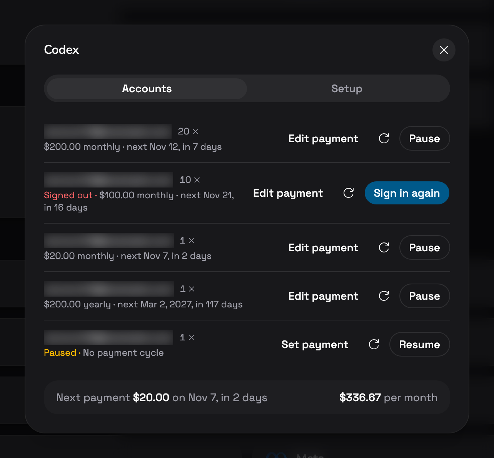
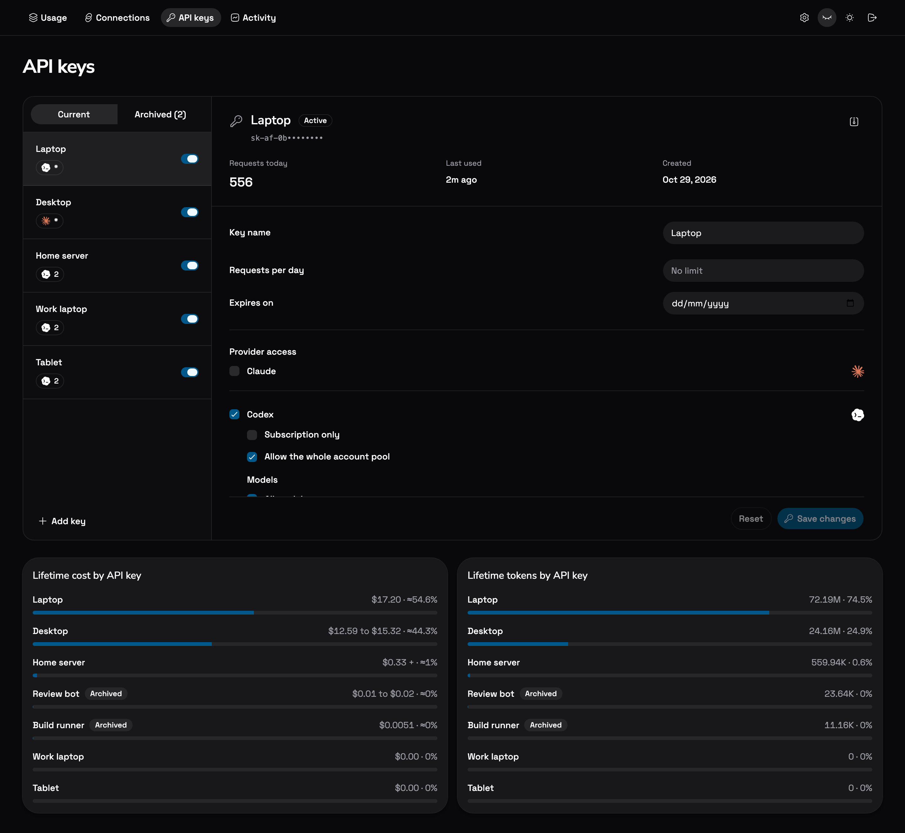

# Accounts and keys

## Adding accounts

Open **Connections**, choose **Add account** on the Codex or Claude card, then pick an account source:

- **OAuth** opens the provider's sign-in. If it ends at an unreachable localhost page, paste that complete callback URL into the dashboard.
- **Auth token** accepts an OAuth access token or a Claude setup token. Codex normally reads the account ID from the token, and you can enter it when needed. A token without refresh credentials works until it expires, then needs replacing.
- **JSON file** imports Codex's `~/.codex/auth.json`, a flat CLIProxyAPI credential file, or Claude Code's `.credentials.json`. Refresh tokens and expiry are kept. Subscription credentials work; API-key-only Codex files are rejected.

Imports go straight into the encrypted store and are usable without a restart. Re-importing or signing in again to a known account keeps its ID, key assignments and pause state. The app never modifies your source file or saves a plaintext copy. Token validity is checked by provider requests, not by parsing the file.

Gemini, Vertex AI, Grok and the other CLIProxyAPI providers appear under **Unsupported** and cannot be connected.

## Quotas

**Manage** on a connection opens two tabs. **Accounts** lists its accounts and lets you pause, resume or archive each one. **Setup** shows the base URL and client configuration. **Refresh** reads quotas from each provider, and background reads run every two minutes. Quotas the provider does not report stay unknown. A failed read keeps the previous value with its timestamp. The dashboard reloads cached metadata every 30 seconds.

Account rows show plan multipliers and any status other than healthy.

The refresh button on an account row in **Manage → Accounts** reads that account's quotas again.

### Archiving accounts

The archive button on an account row pauses the account and moves it under **Archived accounts** at the bottom of the tab. Archived accounts leave the dashboard, pool projections, monthly totals, key editors and the usage hub, and their quotas are no longer read in the background. Their payment cycle, quota history and request history are kept. **Restore** brings an account back paused, so resume it or sign in again when you want it used. Anything that resumes an archived account also takes it out of the archive, so a hidden account never serves requests.

### Signing in again

An account is marked **Signed out** when the provider rejects its credentials. That happens after a revoked or reused refresh token, or a 401 from the quota check. The connection card shows how many accounts are signed out, and the row offers **Sign in again**. Sign in with the same provider account, using any source. Funnel matches the login to the existing account by provider account ID and email, not by credential name, so the account keeps its ID, key assignments, payment cycle and history even after a plan change. A manual pause is kept. An account the SDK disabled because it was signed out is enabled again.

## Payment cycles

Under **Manage → Accounts**, **Set payment** records an account's subscription price, currency, monthly or yearly interval, and one charge date (past or upcoming). The row shows the next payment, repeating from that date and moving to the month's last day when needed (Jan 31 → Feb 28). The tab and the connection card show the total per month, with yearly plans divided by 12 and each currency summed separately. Funnel only displays these values. Removing the account deletes its payment cycle, and re-importing keeps it.

## Banked resets

**Use reset** redeems the displayed banked credit, with its expiry shown underneath. It works for Codex and Claude and is independent of automatic redemption. Claude banks different kinds of reset (5-hour, weekly, Fable and full), so a Claude account gets one button per kind it holds. Each uses that kind's soonest-expiring grant.

**Settings → Use expiring banked resets** redeems Codex and Claude credits during their final five minutes. It is off by default and the setting is stored on the server. While the service runs, the scheduler checks every 15 seconds, refreshes credit status before redeeming, and retries temporary failures or `nothing_to_reset` every 30 seconds until expiry.

Claude grants must be usable, and grants without an expiry are shown but never redeemed automatically. Codex uses T3 Code's deterministic request ID. Claude stores one request ID per redemption, reuses it for unconfirmed requests after restarts, and waits for the remaining count to drop before using another reset from the same grant. A successful redemption clears the account's local cooldown. The banked-reset badge shows counts and expiry details.

Claude lists resets only for recent Claude Code versions. Account requests present the newest version a connected Claude client has used, so keeping clients updated keeps resets visible. When Claude still withholds them, the badge shows its reason.

## API keys

**API keys → Add key** creates a shared key (`sk-af-...`) or registers an existing device key value. Select its providers, accounts and models. Nothing is inherited from another service. Key values are shown once and stored as SHA-256 hashes.

Selecting a key opens its editor. You can change the name, providers, accounts, models, daily request cap and expiry. The key value and usage history stay the same, and changes apply to the next request or WebSocket turn.

Model access uses the same provider catalog as native model discovery. **All models** allows every model, including future ones. Turn it off to pick models from the searchable list.

Daily caps count every authenticated provider request, including model discovery and failed attempts, and reset at midnight UTC.

### Subscription only

**Codex → Subscription only** uses an account only while its live subscription windows have allowance left, including accounts that also have purchased credits. Funnel checks before each execution, retry and WebSocket turn, skips exhausted or unverifiable accounts, and returns 429 when none qualify.

This is a subscription cutoff, not a spending cap. Requests already in flight and delayed provider usage reporting can still spend some purchased credits near the limit.

### Archive

**Archive** revokes a key's access and keeps its settings and lifetime usage. Archived keys are listed under **Archived** and can be restored. A restored key stays paused until you enable it.

## T3 Code usage hub

In **Settings**, generate a hub key. In T3 Code, add a CLIProxyAPI hub with the service's root URL and that management key. Replacing the key invalidates the old one.

To share usage for one client key only, open the key under **API keys** and choose **Generate hub key** in its **Usage hub** section. A per-key hub key:

- lists only the accounts assigned by the key's grants, under opaque IDs, and skips paused accounts;
- labels accounts as `Codex account 1a2b3c` unless **Show account emails** is on, and never shares ChatGPT workspace IDs;
- serves the funnel's cached usage snapshots, reduced to the quota windows T3 Code reads, so it never makes provider calls for reads;
- lists and redeems banked Codex and Claude resets only with **Allow reset redemption** on, while the key and its connection are active;
- keeps showing usage while the key is paused, stops working when the key expires or is archived, and is cleared on archive.

The global hub key in **Settings** sees every account with live provider reads and can redeem resets on any running connection.

The hub exposes `/v0/management/auth-files`, `/v0/management/reset-quota` and a scoped `/v0/management/api-call` for the official Codex and Claude usage endpoints and their reset operations. It does not expose raw SDK management, credentials or arbitrary outbound requests.

Claude resets use Claude's own endpoints through `api-call`, so a hub client can list them, choose one and redeem it:

- `GET https://api.anthropic.com/api/oauth/usage?cedar_ember=1&skip_spend=1` returns usage with the `cedar_ember` reset listing. A bearer that may not redeem gets usage without it.
- `POST https://api.anthropic.com/api/organizations/{organization}/reset_rate_limits` with `{"program":"cedar_ember","grant_id":"…","request_id":"…"}` redeems the chosen grant and answers `{"result":"reset"}`, `already_used`, `not_limited` or `ineligible`. Any organization value works, because the funnel uses the account's own. Repeating a `request_id` returns the first answer without redeeming again.
